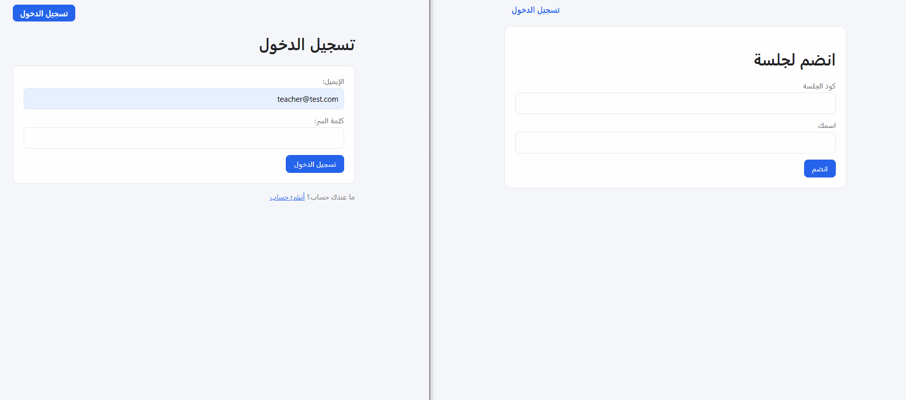

# Activity Builder | منشئ الأنشطة


An Arabic-first (RTL) platform where teachers create interactive activities (multiple choice, ordering, and matching) and share them with students via a link, or run them **live in class** with a join code, real-time scoring, and a leaderboard. Students never need an account.

🔗 **Live demo:** https://activity-builder-chi.vercel.app/



## Features

- Three question types: multiple choice, ordering (drag and drop), and matching (tap to pair)
- Teacher accounts with email authentication (Supabase Auth)
- Activities stored in PostgreSQL and shared through a unique link
- Row Level Security: anyone can view an activity, only its owner can edit or delete it
- Protected routes with redirect back to the requested page after login
- Autosave with debounce, plus an unsaved changes indicator and warning before leaving
- Drag-and-drop ordering with keyboard and button alternatives for accessibility
- Create, edit, and delete questions in a reusable modal form (closes on Escape or backdrop click)
- Dynamic form fields: add and remove ordering items and matching pairs on the fly
- Per-type validation with clear inline error messages, including duplicate detection
- Student mode: one question at a time, instant feedback, progress bar, and final score
- Shuffled ordering items, guaranteed never to start in the correct order
- Full RTL support for Arabic
- Import ready-made questions from Open Trivia DB through a serverless API route
- Student results: students enter a name, attempts are saved, and teachers see scores, averages, and per-question success rates
- Reorder questions in the editor with a drag handle (mouse, touch, or keyboard)

### Live sessions

- The teacher starts a session from the dashboard and gets a 6-character join code
- Students join at `/join` with the code and a name, no account needed
- Real-time lobby: the teacher sees who is connected (Supabase Realtime Presence)
- The teacher controls the pace: next question, then reveal the correct answer
- The teacher picks the scoring for each session: fixed points, or a small speed bonus on top of a base score
- A live leaderboard where tied players share a rank
- After each reveal, students see their points, total, rank, and the top five
- Ending a session shows the final standings and closes the join code
- Recovery: the teacher can refresh, or continue from another device, without losing answers and scores: revealed questions are rebuilt from the saved results, and students send their answer again when the host repeats the question. Students come back to the same session with the same identity
- Students who join late or refresh get the current question again
- The channels are private: only the teacher can send questions, reveals, and the end of a session. Students sign in anonymously (still no account) and can only send answers
- Live sessions currently support multiple choice questions only
- Results are saved to the database as each question is revealed, and a review page shows the standings and the success rate of every question
- Past sessions are listed for each activity, and an ended session can be deleted

#### How a live session works

1. The teacher clicks **Live session** on an activity. The database creates a session with a unique code.
2. Students open `/join` and enter the code. The code is checked through a database function, never by reading the table.
3. Students sign in anonymously, then everyone connects to two private Realtime channels. The teacher sends each question **without its correct answer** on one, and students send back only their choice on the other.
4. On **Reveal**, the teacher's browser scores the answers, saves the new state **and the session results** to the database in one request, and broadcasts the correct answer with each student's result.

## Design decisions (live sessions)

**Security**
- No public read policy on `live_sessions`. Students join through a `security definer` function that returns at most one active session and has a fixed `search_path`, so nobody can list all codes. A 6-character code is short, so it needs a different access model than the long, unguessable activity link.
- Session creation runs with the caller's rights, so the policy still checks that the activity belongs to the teacher, and it is granted to authenticated users only.
- The correct answer is never part of the question broadcast. `toPublicQuestion` copies an explicit list of fields (a whitelist, not "everything except the answer"), so a field added later stays private by default. The receiving schema also strips unknown fields, and both layers have tests.
- Everything that arrives through the channel is untrusted and validated with Zod before use. Player ids are compared with `Object.hasOwn`, so a client cannot claim an inherited key like `constructor`.
- Time is measured by the teacher's browser when an answer arrives. Students never send a timestamp, so it cannot be forged.
- Saved results contain student names. The table has no public read policy, so only the teacher who owns the session can read them.
- The channels are private, and policies on `realtime.messages` decide who can join and who can send. A live session uses two topics, because a policy can only look at the topic and the type of message, not at the event name: on `live:CODE` only the host can broadcast (students can read it and announce their presence), and students send their answers on `answers:CODE`. This is what stops a student from sending a fake question, reveal, or end of session.
- Students sign in anonymously with a separate client whose session lives in `sessionStorage`, so each tab is its own identity and a shared device does not leak one. Anonymous users use the `authenticated` role, so the policy that lets teachers create activities refuses them explicitly (a restrictive policy on the `is_anonymous` claim).
- The policies cannot read `live_sessions` (only the host may), so two `security definer` functions answer yes or no and nothing else.
- Public channels are refused (the "Allow public access to channels" setting is off), so a channel that is not private cannot be opened with the public key.
- Only an ended session can be deleted. The rule is enforced by a database policy, not only by hiding the button.

**Correctness**
- State changes are conditional in the database (`state->>status`, `ended_at is null`) and checked for zero affected rows, so a double click cannot score a question twice or end a session twice.
- Scores are stored per question and overwritten, and totals and ranking are derived. Recomputing a question can never double count.
- Concurrent answers use functional state updates (`prev => ...`), so two answers arriving together both survive.
- The first answer of a player wins, and broadcasts are sent with server acknowledgement, so "sent" means delivered, not just pushed.
- The saved results are rebuilt from the host's data on every reveal and written over the previous copy in the same request as the state change, so a retry cannot duplicate them. They are keyed by question id, not position, and keep a copy of the question text, so a review still makes sense after the activity is edited.

**Recovery**
- The teacher's answers and scores are saved in `localStorage` and validated with Zod when restored.
- On load, the host's data for every question already revealed is rebuilt from the saved results, matched by question id so that editing the activity later does not misplace it. This browser's own copy only fills in what the database does not know, such as the answers to a question that is still open. Without this, revealing a question on a second device overwrote the saved results with that question alone.
- A student's page sends its saved answer again whenever the host repeats the current question, so a host that lost its copy (another device, cleared data, a reload) collects the answers of a question that is still open. Repeating is harmless because the host keeps only the first answer of each player.
- A student's identity and last answer are kept in `sessionStorage`, so a refresh keeps the same score and cannot change an answer. It is cleared when the tab closes, so a shared device does not leak identities.
- The student's page is idempotent: the host may repeat the current question, and a student who already has it ignores the repeat.

## Known limitations

- **A student can answer on behalf of another student.** The answer carries a player id that other students can see in the lobby, and a policy cannot look inside a message. Per-student answer topics would fix it.
- **Correct answers are still stored in `activities`**, which anyone with the activity link can read. A technical student could fetch them from the API. Hiding them needs a view or a function that omits `correctIndex` for public reads.
- **A determined student can listen to the answers channel.** Joining a private channel needs the permission to read it, so students can read it in order to send on it. Anyone signed in who knows an active code (even another teacher) can read the channels like a student. The top-five names are broadcast to everyone by design.
- **The teacher's browser is the host.** If it is closed, the session stops. Answers to a question that is still open live in that browser, but students send theirs again when the host repeats the question, so a new device or a reloaded page collects them back. In speed mode a re-sent answer is timed when it arrives again, so it earns less of the speed bonus. Revealed questions are saved in the database and are restored on any device.
- **In speed mode, points depend on network latency**, because time is measured when the teacher receives the answer.
- **Sessions that are never ended stay joinable.** There is no automatic expiry yet.
- Supabase Realtime has usage limits on the free plan. Check the current limits before running a large class.
- **Anonymous sign-ins** are limited per IP address per hour (raised from 30 to 300 in the dashboard, because a class shares one address), they are not cleaned up automatically, and there is no CAPTCHA.
- **Access checks use a connection pool in Realtime** (a dashboard setting): a very large class joining at once may need it raised.
- **The free Realtime plan allows 100 events per second**, and every answer is delivered to everyone in the session, so a class of about 25 is comfortable, while a much bigger class answering at the same moment may be disconnected for a moment (the client reconnects by itself).
- **Deleting an activity also deletes all of its saved sessions.**

## Tech Stack

- React + TypeScript (Vite)
- React Router
- Supabase (PostgreSQL, Auth with anonymous sign-ins, Row Level Security, Realtime Presence and Broadcast on private channels)
- Zod (runtime validation)
- dnd-kit (drag and drop)
- Vitest + React Testing Library
- GitHub Actions (CI)
- CSS with custom properties
- Deployed on Vercel

## What I Learned

### Security & Data
- Securing data with Row Level Security instead of relying on hidden keys, including policies across related tables (anyone can submit an attempt, only the owner can read it)
- Detecting silent RLS failures: updates that succeed with zero affected rows, and inserts that fail when chained with `.select()`
- Validating database data at runtime with Zod, deriving TypeScript types from the same schemas
- Linking answers to stable question IDs instead of array positions, and migrating legacy data when a stored shape changes
- Keeping secret API keys off the client with a serverless proxy
- Choosing an access model by the secret's strength: an unguessable link can use public read, a short join code needs a restricted `security definer` function
- Using Realtime Authorization: policies on `realtime.messages` that can only see the topic and the message type, so roles are separated by channel
- Reading the current docs at their source, and then finding where the real service behaves differently from them (joining a private channel needs the read permission), which only a test on a real project can show
- Remembering that anonymous users share the `authenticated` role, and reviewing the existing policies for what they would now allow

### Real-time & Untrusted Clients
- Using Supabase Realtime Presence for a live lobby and Broadcast for events, and learning that `send()` resolves immediately unless acknowledgement is enabled
- Treating every channel payload as untrusted: validating with Zod, whitelisting the fields that leave the server, and never broadcasting a secret
- Designing idempotent updates: derived totals, conditional database transitions, and handlers that ignore repeated events
- Making a session recoverable after a refresh, and finding that a ref-based restore wiped saved data under React StrictMode (fixed by moving the flag to state, with a regression test)
- Avoiding stale closures in event handlers with functional updates and a latest-callback ref
- Saving state that is derived from in-memory data in the same request as each state change, so a retry overwrites instead of duplicating
- Finding a data-loss bug (revealing a question on a second device overwrote the saved results) by writing the failing test first, then fixing it and checking that the fix is tested by breaking it on purpose
- Making a message safe to repeat (the first answer wins) and using that to recover lost state without adding a server endpoint

### React Patterns
- Designing components around shared interfaces (`onAnswer`, `onFinish`) so new question types and features plug in without rewrites
- Handling async data with loading/error/not-found states, and avoiding race conditions in effects
- Debouncing autosave, with a ref-based revision counter so edits made during a save are never lost
- Resetting state with the `key` prop, deriving values instead of storing them, and extracting custom hooks
- Code splitting with `React.lazy` and `Suspense`
- Keeping pages thin: pure logic in `utils/`, behaviour in hooks, markup in small components, and a loader/view split so the view can assume its data exists
- Refactoring in small steps (one extraction per commit), with tests and a manual check after each, and moving code verbatim instead of rewriting it

### TypeScript
- Modeling question types and session states as discriminated unions with exhaustive `never` checks, so the compiler lists every place to update when a type is added
- Migrating a JavaScript codebase to TypeScript incrementally without breaking the app

### Testing & CI
- Extracting logic into pure functions (scoring, ranking, public question building) to make it testable
- Testing components by role and accessible name, and mocking randomness with `vi.mock` only where needed
- Testing hooks with `renderHook`, fake timers, and StrictMode
- Using `it.each` to cover dangerous inputs such as `constructor`, `NaN`, and out-of-range choices
- Breaking the code on purpose to confirm each test fails when it should
- Writing regression tests that lock in fixed bugs
- Running type checks, tests, and builds on every push with GitHub Actions
- Testing hooks that talk to Supabase and Realtime by mocking only those two boundaries, and breaking the code on purpose to check that each safety rule has a test that fails

## Project Structure

```
.github/
└── workflows/
    └── ci.yml               # Type check, tests, and build on every push
api/
└── trivia.ts                # Serverless function proxying the trivia API
supabase/
└── schema.sql               # Tables (activities, attempts, live_sessions), RLS policies, session functions
src/
├── types.ts                 # Shared types: questions, activities, sessions, events
├── schemas.ts               # Zod schemas (source of truth for types and channel events)
├── constants.ts             # Shared constants (question time limit)
├── vite-env.d.ts            # Types for environment variables
├── pages/
│   ├── DashboardPage.tsx    # Teacher's list of activities
│   ├── EditorPage.tsx       # Loads, edits, and saves one activity
│   ├── BuilderPage.tsx      # Question management UI (used by the editor)
│   ├── ActivityPage.tsx     # Loads an activity from a shareable link
│   ├── PlayPage.tsx         # Student play flow (used by the activity page)
│   ├── ResultsPage.tsx      # Attempts and per-question stats for the teacher
│   ├── LiveHostPage.tsx     # Loads a live session, then draws the teacher's screen
│   ├── JoinPage.tsx         # The student's live screen (only draws)
│   ├── SessionReviewPage.tsx # Review of a finished live session
│   ├── SessionsPage.tsx     # Past live sessions of an activity, with delete
│   └── LoginPage.tsx
├── components/
│   ├── form/                # Form fields for each question type
│   ├── play/                # Play components for each question type
│   ├── live/                # Live session pieces: Leaderboard, PlayerList, ScoringPicker,
│   │                        #   JoinForm, StudentQuestion, FinalStandings
│   ├── Modal.tsx
│   ├── RequireAuth.tsx      # Redirects to login for protected routes
│   ├── QuestionForm.tsx
│   ├── QuestionItem.tsx
│   └── QuestionList.tsx
├── context/
│   ├── AuthContext.ts       # The context object
│   ├── AuthProvider.tsx     # Session state and auth actions
│   └── useAuth.ts           # Hook to read auth state anywhere
├── hooks/
│   ├── useSortSensors.ts    # Shared drag-and-drop sensors
│   ├── useLiveSession.ts    # Loads a live session and its questions
│   ├── useHostGame.ts       # The teacher's game: answers, scoring, state changes
│   ├── useStudentGame.ts    # The student's game: join, recover, answer
│   ├── useActivitySessions.ts # Lists the past sessions of an activity and deletes one
│   ├── useLiveChannel.ts    # Two private channels (live, answers): presence, send and receive, anonymous sign-in for students
│   ├── useHostSnapshot.ts   # Saves and restores the host's answers and scores
│   └── useOnNewPlayers.ts   # Detects new players so the host can re-send the current state
├── test/
│   └── setup.ts             # Test setup (jest-dom matchers, cleanup)
├── lib/
│   ├── supabase.ts          # Supabase client
│   ├── trivia.ts            # Fetches and maps trivia questions
│   ├── joinSession.ts       # Checks a join code through the join_session function
│   └── playerStorage.ts     # A student's identity and last answer, per tab
│   ├── studentSupabase.ts   # A separate client for students: an anonymous identity kept in the tab
└── utils/                   # Pure logic, each file unit tested next to it
    ├── shuffle.ts
    ├── validateQuestion.ts
    ├── toPublicQuestion.ts  # Removes the correct answer before a question is broadcast
    ├── summarizeAnswers.ts  # Counts answers per option for connected players
    ├── summarizeSession.ts  # Turns a saved session into review data
    ├── summarizeSessionList.ts # Rows for the past sessions list, newest first
    ├── calculateScore.ts    # Points for one answer, based on speed
    ├── scoreQuestion.ts     # Scores every answer of a question, and sums totals
    ├── buildLeaderboard.ts  # Sorted board with tie-aware ranks
    ├── buildRevealSummary.ts
    ├── buildFinalSummary.ts
    ├── buildSessionResults.ts  # Saved record of a session, built from the host's data
    ├── hostSnapshot.ts      # Parses and validates the host's saved state
    ├── restoreSnapshot.ts   # Rebuilds the host's data from saved results, and merges it with this browser's copy
    └── storedPlayer.ts      # Parses and validates a student's saved identity
```

## Run Locally

1. Create a free project on [Supabase](https://supabase.com) and run `supabase/schema.sql` once in the SQL Editor. It expects an empty project: it creates the tables, the policies, and the live session functions, and running it a second time fails with "already exists".
2. Create a teacher account (Authentication, then Users, then Add user). For local testing you can turn off email confirmation in the Auth settings.
3. For live sessions, in the Supabase dashboard: turn on **Allow anonymous sign-ins** (Authentication, Sign In / Providers), raise the anonymous sign-ins limit (Authentication, Rate Limits: the default is 30 per hour per IP address, and a class behind one address needs more), and turn off **Allow public access to channels** (Realtime, Settings) so that only private channels work. Anonymous users are not cleaned up automatically, so from time to time run `delete from auth.users where is_anonymous is true and created_at < now() - interval '30 days';`.
4. Create a `.env.local` file in the project root:

```
VITE_SUPABASE_URL=your-project-url
VITE_SUPABASE_PUBLISHABLE_KEY=your-publishable-key
```

3. Install and run:

```bash
npm install
npm run dev
```

To run the API routes locally (used by question import), use the Vercel CLI instead:

```bash
npm install -g vercel
vercel dev
```

Run the type check and the tests:

```bash
npm run typecheck
npm run test:run
```

To try a live session on one computer, open the teacher's page in one window and `/join` in a private window.

## Roadmap

- [x] Multiple choice questions
- [x] Ordering questions with drag and drop
- [x] Matching questions
- [x] User accounts and shareable activity links (Supabase)
- [x] TypeScript migration
- [x] Autosave in the editor
- [x] Runtime validation of database data (Zod)
- [x] Student results and per-question statistics for teachers
- [x] Store question IDs with each answer so stats stay accurate after a teacher edits questions
- [x] Reorder questions with drag and drop in the editor
- [x] Tests for ordering and matching questions
- [x] Live sessions: join code, real-time questions, configurable scoring, and a leaderboard
- [x] Recovery after a refresh for both the teacher and the students
- [x] Save live session results and review them on a page
- [x] List past sessions for each activity, and delete a session
- [x] Restore a live session from its saved results on another device
- [x] Students send their answer again after the host switches device in the middle of a question
- [x] Private Realtime channels: only the teacher can send questions and reveals
- [ ] Hide correct answers from public reads
- [ ] Ordering and matching questions in live sessions
- [ ] Expire live sessions that were never ended
- [ ] AI-generated questions in Arabic from a topic (serverless function)
- [ ] Images in questions (Supabase Storage)
- [ ] Integration test for the full play flow (answer, score, and onFinish)
- [ ] Re-enable email confirmation and add password reset
- [ ] Per-student answer channels (answers private to the teacher, and nobody can answer on behalf of another student)