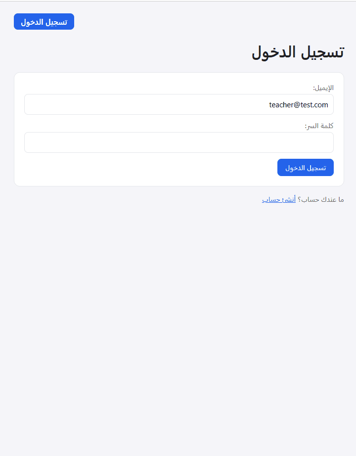

# Activity Builder | منشئ الأنشطة


An Arabic-first (RTL) platform where teachers create interactive activities (multiple choice, ordering, and matching) and share them with students via a link. Students solve them with instant feedback, no account needed.

🔗 **Live demo:** https://activity-builder-chi.vercel.app/



## Features

- Three question types: multiple choice, ordering (drag and drop), and matching (tap to pair)
- Teacher accounts with email authentication (Supabase Auth)
- Activities stored in PostgreSQL and shared through a unique link
- Row Level Security: anyone can view an activity, only its owner can edit or delete it
- Protected routes with redirect back to the requested page after login
- Autosave with debounce, plus an unsaved changes indicator and warning before leaving
- Drag-and-drop ordering with keyboard and button alternatives for accessibility
- Create, edit, and delete questions in a reusable modal form (closes on Escape or backdrop click)
- Dynamic form fields: add and remove ordering items and matching pairs on the fly
- Per-type validation with clear inline error messages, including duplicate detection
- Student mode: one question at a time, instant feedback, progress bar, and final score
- Shuffled ordering items, guaranteed never to start in the correct order
- Full RTL support for Arabic
- Import ready-made questions from Open Trivia DB through a serverless API route
- Student results: students enter a name, attempts are saved, and teachers see scores, averages, and per-question success rates

## Tech Stack

- React + TypeScript (Vite)
- React Router
- Supabase (PostgreSQL, Auth, Row Level Security)
- Zod (runtime validation)
- dnd-kit (drag and drop)
- Vitest + React Testing Library
- GitHub Actions (CI)
- CSS with custom properties
- Deployed on Vercel

## What I Learned

- Securing data with Row Level Security instead of relying on hidden keys
- Detecting silent update failures caused by RLS (checking affected rows)
- Sharing auth state across the app with React Context and a custom hook
- Handling async data fetching with loading, error, and not-found states, and avoiding race conditions
- Designing components around a shared interface (`onAnswer`) so new question types plug in without changing the play page
- Replacing a lookup object with an exhaustive switch, because TypeScript couldn't guarantee the looked-up component matched the question type
- Lifting state up to share data between routes, and keeping state colocated where it is used
- Resetting component state using the `key` prop instead of syncing with `useEffect`
- Handling stale state (e.g. deleting a question while it is being edited)
- Refactoring code structure without changing behavior
- Building accessible drag and drop with keyboard and button alternatives
- Cleaning up event listeners and subscriptions in `useEffect`
- Modeling question types as a discriminated union so the compiler flags every place to update when a new type is added
- Exhaustive checks with `never` in switch statements
- Validating database data at runtime with Zod, and deriving TypeScript types from the same schemas so there is one source of truth
- Migrating a JavaScript codebase to TypeScript incrementally without breaking the app
- Code splitting with React.lazy and Suspense so each page loads only when visited
- Keeping secret API keys off the client by proxying requests through a Vercel serverless function
- Debouncing autosave with useEffect cleanup, and using a ref-based revision counter to avoid losing edits made during a save
- Extracting logic into pure functions to make it testable, and unit testing it with Vitest
- Testing components the way users use them with React Testing Library (roles, clicks, and accessible names)
- Running type checks, tests, and builds on every push with GitHub Actions
- Relating tables with foreign keys and cascade deletes, and enforcing data rules with check constraints in the database
- Writing RLS policies across related tables: anyone can submit an attempt, only the activity owner can read it
- Avoiding insert().select() when the user can write but not read a row under RLS
- Fetching independent data in parallel with Promise.all
- Linking stored answers to stable question IDs instead of array positions, and handling legacy data when a stored shape changes

## Project Structure

```
.github/
└── workflows/
    └── ci.yml               # Type check, tests, and build on every push
api/
└── trivia.ts                # Serverless function proxying the trivia API
supabase/
└── schema.sql               # Tables (activities, attempts) and RLS policies
src/
├── types.ts                 # Shared types: questions, activities, play props
├── schemas.ts               # Zod schemas (source of truth for question types)
├── vite-env.d.ts            # Types for environment variables
├── pages/
│   ├── DashboardPage.tsx    # Teacher's list of activities
│   ├── EditorPage.tsx       # Loads, edits, and saves one activity
│   ├── BuilderPage.tsx      # Question management UI (used by the editor)
│   ├── ActivityPage.tsx     # Loads an activity from a shareable link
│   ├── PlayPage.tsx         # Student play flow (used by the activity page)
│   ├── ResultsPage.tsx      # Attempts and per-question stats for the teacher
│   └── LoginPage.tsx
├── components/
│   ├── form/                # Form fields for each question type
│   ├── play/                # Play components for each question type
│   ├── Modal.tsx
│   ├── RequireAuth.tsx      # Redirects to login for protected routes
│   ├── QuestionForm.tsx
│   ├── QuestionItem.tsx
│   └── QuestionList.tsx
├── context/
│   ├── AuthContext.ts       # The context object
│   ├── AuthProvider.tsx     # Session state and auth actions
│   └── useAuth.ts           # Hook to read auth state anywhere 
├── test/
│   └── setup.ts             # Test setup (jest-dom matchers, cleanup)
├── lib/
│   ├── supabase.ts          # Supabase client
│   └── trivia.ts            # Fetches and maps trivia questions
└── utils/
    ├── shuffle.ts
    └── validateQuestion.ts  # Pure validation logic, unit tested    
```

## Run Locally

1. Create a free project on [Supabase](https://supabase.com) and run the SQL in `supabase/schema.sql` in the SQL Editor.
2. Create a `.env.local` file in the project root:

```
VITE_SUPABASE_URL=your-project-url
VITE_SUPABASE_PUBLISHABLE_KEY=your-publishable-key
```

3. Install and run:

```bash
npm install
npm run dev
```

To run the API routes locally (used by question import), use the Vercel CLI instead:

```bash
npm install -g vercel
vercel dev
```

Run the tests:

```bash
npm test
```

## Roadmap

- [x] Multiple choice questions
- [x] Ordering questions with drag and drop
- [x] Matching questions
- [x] User accounts and shareable activity links (Supabase)
- [x] TypeScript migration
- [x] Autosave in the editor
- [x] Runtime validation of database data (Zod)
- [x] Student results and per-question statistics for teachers
- [x] Store question IDs with each answer so stats stay accurate after a teacher edits questions
- [ ] Reorder questions with drag and drop in the editor
- [ ] Tests for ordering and matching questions